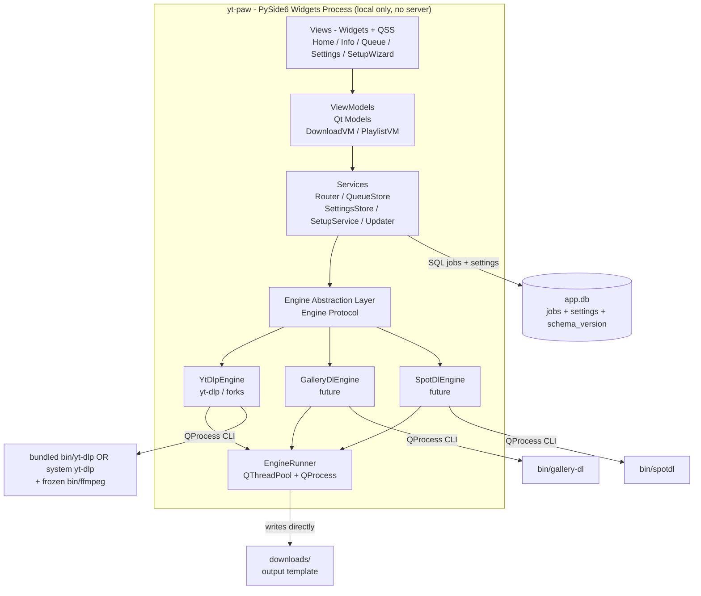
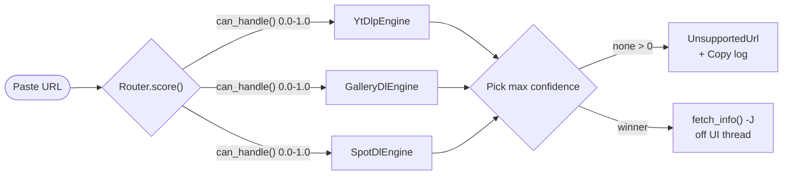
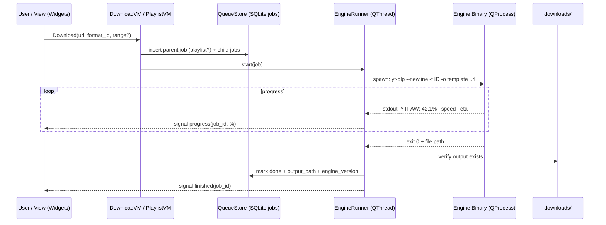
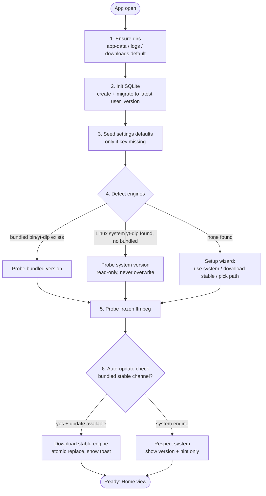

# yt-paw — Architecture

**Status:** Phase 0 ✅ · Phase 1 ✅ · Phase 2 ✅ · Phase 3 ✅ · engine decoupled
via registry · **Phase 4 in progress (4a per-engine settings done)** ·
mypy --strict clean · **Date:** 2026-10-05
**Scope:** Local-first desktop frontend for video/audio download engines.
**License target:** MIT (application code).
**Run (dev):** `yt-paw` (editable install) · pickup: `plan/currentStatus.md`.

---

## 1. Overview

yt-paw is a lightweight, local-only desktop application that provides a simple,
memorable UI for downloading media via pluggable backend engines.

The reference engine is `yt-dlp` (or any CLI-compatible fork), invoked as an
**external binary**, not as a Python library. The architecture explicitly
supports additional engines (e.g., anime/gallery engines such as `gallery-dl`,
Spotify-oriented grabbers such as `spotDL`) through a generic `Engine`
abstraction.

Design motto: **simple, yet feature rich.** v1 covers paste-URL → inspect →
pick quality → download, including playlists. Power features are additive and
must not complicate the default path.

---

## 2. Goals and Non-Goals

### 2.1 Goals

1. **Memorable simplicity:** A non-technical friend can paste a URL and get a
   file without reading documentation.
2. **Decoupled engine releases:** An upstream `yt-dlp` extractor fix must not
   require a new yt-paw release.
3. **Fork resilience:** If `yt-dlp` is banned, restricted, or forked (e.g., EU
   regulatory risk), the user can point yt-paw at a fork binary with zero code
   changes.
4. **Generic engine model:** Support heterogeneous engines (YouTube-style,
   gallery/anime-style, audio/Spotify-style) behind one queue, one history,
   one download directory.
5. **Light footprint:** No browser engine, no local web server, no Electron.
   Target cold start < 2s, idle RAM < 150 MB, app payload < 80 MB (excluding
   the bundled Deno/FFmpeg sidecars).
6. **MIT-clean:** All application code MIT. All dependencies must be
   MIT/BSD/Apache-2.0/Unlicense/LGPL-dynamic compatible. No GPL copyleft in
   the distribution chain.
7. **Offline-first privacy:** No telemetry, no accounts, no remote API. All
   processing is local; network traffic is only between engines and target
   sites.

### 2.2 Non-Goals (v1)

- No hosted/SaaS mode. No multi-user server.
- No built-in player, transcoding studio, or library manager. yt-paw downloads
  files; playback is delegated to the OS.
- No DRM circumvention beyond what the underlying engine lawfully supports.
- No automatic copyrighted-content re-upload or sharing features.

---

## 3. Tech Stack

| Layer | Choice | Rationale |
|-------|--------|-----------|
| Language | Python 3.11+ | Native fit for engine ecosystem, easy `QProcess` orchestration. 3.11 for faster startup, improved error messages, `ExceptionGroup`. |
| GUI toolkit | **PySide6 (Qt 6, Widgets) — locked** | Only Qt Python binding compatible with MIT distribution (LGPL). PyQt6 is GPL/commercial and is rejected. **Widgets always** — no QML, no QtWebEngine. Single-window utility stays light and QSS-themeable. |
| Styling | QSS + SVG icons | QSS gives CSS-like theming without bundling Chromium. Theme files are swappable at runtime. |
| Engine integration | `QProcess` + JSON-over-stdout | Decouples app releases from engine releases. Stable CLI contract (`-J`, `--newline`, progress templates). Allows fork swapping by path. |
| Concurrency | `QThreadPool` + `QProcess` + Qt signals/slots | Keeps UI thread free. One worker per download job; bounded pool (default 2 concurrent). Progress via signal emission, never direct widget mutation from workers. |
| Persistence | SQLite only (`sqlite3` stdlib) | Single `app.db` holds `jobs` + `settings`. No TOML/INI/YAML config files. `QSettings` used only for transient Qt window geometry; all domain settings live in SQLite. No ORM in v1; `dataclasses` + thin repository layer. |
| Engine registry | Python modules + SQLite overrides | Engines are `engines/<id>.py` classes. User overrides (binary path, args template, enabled) stored in `engine_settings` table, not config files. |
| Packaging | PyInstaller one-folder (Windows x86_64 / Linux x86_64) + per-platform pinned sidecars `yt-dlp`, `ffmpeg` (BtbN LGPL shared), `deno` in `bin/` (FFmpeg `.so` files in `lib/` on Linux) | Team experience with PyInstaller; Nuitka not evaluated. One-folder avoids single-file AV false positives and enables in-place engine update (replace `bin/yt-dlp`). Sidecars are hash-pinned and verified at build time (`docs/packaging.md`). |
| Testing | `pytest` + `pytest-qt` | Headless widget tests in CI (`QT_QPA_PLATFORM=offscreen`). Engine contract tests use fixture JSON, not live network. |
| Lint/format | `ruff` + `mypy` (strict on core) | Fast, minimal config. Type hints mandatory on engine interface and services. |

### 3.1 Explicitly Rejected Alternatives — Decided

- **PyQt6:** License incompatible with MIT goal. PySide6 only.
- **QML / QtWebEngine:** Rejected. **Widgets always** per owner decision.
- **Nuitka / Briefcase:** Not evaluated. **PyInstaller** per team experience.
- **TOML/INI/YAML config files:** Rejected. SQLite `settings` table is the
  single source of truth (see §8).
- **Electron / Tauri + web UI:** Heavier runtime (Electron) or sidecar complexity
  without Python-lib benefit (Tauri). Justified only if a remote/web mode is
  added later.
- **FastAPI localhost + browser UI:** Adds a server to secure/sandbox, two
  processes to manage, and browser-tab UX. Simpler to stay in-process with Qt.
- **`yt-dlp` as Python lib (`import yt_dlp`):** Superior API ergonomics but
  forces app re-release on every extractor break and complicates frozen-app
  updates. Rejected for v1; may return as an *optional* in-process engine
  behind the same `Engine` interface.

---

## 4. System Architecture

### 4.1 High-Level Component Diagram



### 4.2 URL-to-Engine Routing Flow



### 4.3 Download Lifecycle (Sequence)



### 4.4 First-Run Self-Setup (App Sets Itself Up on Open)

No manual setup. Every launch runs `SetupService.ensure_ready()` before the
main window is interactive. **First run = no `app.db`** (`SetupResult.first_run`).
On first run, `SetupWizardDialog` offers: *Use system install* (when one is
found on PATH, source=system), *Download automatically* (source=auto, starts
the managed download), *Choose binary…* (source=path), or *Set up later*
(keeps the seeded default: source=auto for engines with an `update_repo`, so
a clean machine downloads its engine at startup with banner progress).



- **UI process only.** No daemon, no server port. All state lives in the Qt
  process; engines are short-lived child processes.
- **Unidirectional data flow:** View (Widgets) → ViewModel → Service →
  Engine → QProcess. Progress and completion flow back via Qt signals.
- **Filesystem as output:** Engines write directly to `downloads/` via `-o`
  templates. The app never proxies bytes; it only monitors progress and
  verifies output.
- **Self-setup on open:** `SetupService` guarantees dirs, DB, settings seeds,
  engine discovery, and ffmpeg probe before first interaction (see §4.4).
  The app is never in a half-configured state.

---

## 5. Engine Abstraction (Core Design Decision)

### 5.1 Motivation

- Upstream churn: video sites change weekly; `yt-dlp` ships frequently.
- Legal/fork risk: the app must survive engine renames, bans, or regional
  blocks by allowing config-only engine swaps.
- Heterogeneity: anime/gallery and Spotify-style tools have different flags,
  auth models, and metadata shapes, but share queue/progress/history needs.

### 5.2 Engine Interface — Implemented

Every engine is a module implementing the `domain.engines_base.Engine` protocol
and registered in `engines/registry.py`. **Consumers (scheduler, runner, info
fetcher, setup, view models, views) must never import a concrete engine** —
only the registry + domain. (Refactor 2026-10-05: core was cored directly on
yt-dlp; now registry-driven. `tests/test_engine_interface.py` proves a fake
engine flows through routing/enqueue with zero core edits.)

```python
class Capability(Flag):
    SINGLE_URL      = auto()
    PLAYLIST        = auto()
    FORMAT_PICKER   = auto()
    AUDIO_EXTRACT   = auto()
    SUBTITLES       = auto()
    AUTH_COOKIES    = auto()
    SELF_UPDATE     = auto()

class Engine(Protocol):
    engine_id: str
    display_name: str
    binary_name: str        # bundled bin/<name> + PATH lookup
    capabilities: Capability
    settings_defaults: dict[str, object]     # seeded into engine_settings
    default_formats: list[tuple[str, str]]   # (label, selector) UI fallback

    def can_handle(self, url: str) -> float: ...          # 0.0–1.0 confidence
    def is_playlist_url(self, url: str) -> bool: ...
    def build_info_args(
        self, binary: str, url: str, playlist: bool, cookies_file: str | None
    ) -> list[str]: ...
    def parse_info_json(self, raw: str, url: str) -> MediaInfo: ...
    def build_download_args(
        self,
        binary: str,
        url: str,
        output_template: str,
        options: DownloadOptions,           # format + subtitles (per job)
        cookies_file: str | None,           # per engine (Settings)
    ) -> list[str]: ...
    def parse_progress_line(self, job_id: str, line: str) -> ProgressUpdate | None: ...
    def probe_version(self, binary: str) -> str: ...
```

Data types: `MediaInfo` (engine_id, url, title, uploader, duration_s,
is_playlist, playlist_count, formats, thumbnail_url, entries) and
`FormatOption`/`PlaylistEntry`/`ProgressUpdate` live in `domain/engines_base.py`.
`format_selector`/`format_id` are opaque to the UI: it round-trips whatever the
engine's `default_formats` or `fetch_info` produced.

Wiring points (all generic):

- `engines/registry.py` — `register`, `get_engine`, `all_engines`,
  `pick_engine` (max `can_handle` score; raises on unsupported URLs).
- `infra/scheduler.py` — resolves engine from job row, gets binary from
  `dict[engine_id, path]`, builds args + passes `parse_progress_line` to the
  runner. Missing binary ⇒ job fails with a friendly message.
- `infra/runner.py` — engine-agnostic: injected parse callable.
- `infra/info_fetcher.py` — engine injected per fetch; identity-checked proc.
- `infra/detail_store.py` — `detail_store_for(conn, engine_id)` maps to the
  engine's `job_<engine>` table (or `None`); `format_selector(job_id)` used by
  the scheduler.
- `infra/setup_service.py` — discovery per engine: `binary_path` override →
  bundled `bin/<binary_name>` → system `PATH`; seeds `settings_defaults`.
- UI views — receive `engine.default_formats` via `set_fallback_formats()`.

Rules (unchanged):

1. `format_id` is opaque. The UI never parses it; it round-trips it.
2. `can_handle` returns confidence, not boolean, to allow overlapping engines
   (e.g., generic yt-dlp 0.6 vs dedicated gallery engine 0.9).
3. All blocking I/O lives in workers. Info fetch and downloads always run off
   the UI thread (`QProcess` + signals).
4. Engines must be **MIT/Unlicense-compatible** or external binaries the user
   supplies. No GPL engine may be bundled.

### 5.3 Reference Implementation: `YtDlpEngine`

Wraps **any** `yt-dlp`-family binary (`yt-dlp`, `youtube-dl`, forks) via CLI.
Playlist support is first-class, not a flag afterthought (see §5.6).

- **Discovery (in order):**
  1. User override from `engine_settings` (`ytdlp.binary_path`).
  2. Bundled sidecar `bin/yt-dlp[.exe]` shipped with the app.
  3. System `PATH` (`shutil.which("yt-dlp")`) — common on Linux.
  Resolved path + origin (`bundled|custom|system`) + version are shown in the
  footer and stored per-job (`engine_version`, `engine_origin`) for
  reproducibility.
- **Info:**
  - Single: `yt-dlp -J --no-warnings <url>` → normalized `MediaInfo`.
  - Playlist: `yt-dlp -J --flat-playlist --no-warnings <url>` → parent
    `MediaInfo(is_playlist=True)` + child entry list (id, title, index).
    Full per-entry dump is lazy (only for selected range) to stay fast.
  Timeout 30s, kill on cancel.
- **Download:**
  `yt-dlp --newline --no-colors --progress-template "YTPAW:%(progress._percent_str)s:%(progress._total_bytes_str)s:%(info.title)s" -o "<outtmpl>" -f <format_id> [--yes-playlist --playlist-start N --playlist-end M] <url>`
  Progress parsed line-wise via regex; emitted as `ProgressUpdate`.
  Playlist range selection maps directly to `--playlist-start/end` or to
  enqueuing N child jobs (default: child jobs, so retry/cancel is per-entry).
- **Update policy (auto at startup):**
  - Bundled engine → **stable channel, auto-update at startup** (check, then
    atomic replace `bin/yt-dlp.new` → `bin/yt-dlp`). Toast shows old → new.
    No app release required. User can disable via
    `engine_settings(ytdlp, auto_update)=false`.
  - System engine (Linux `PATH`) → **never overwrite.** Show version + distro
    hint (`apt/dnf/pacman/pipx`). Offer “Switch to bundled stable” action.
  - Source: `https://github.com/yt-dlp/yt-dlp/releases/latest/download/`
    with SHA256 verification where published, HTTPS allowlist enforced.
- **Args template:** stored in `engine_settings`
  (`ytdlp.info_args`, `ytdlp.download_args`) so forks with
  divergent flags work with zero code changes.

### 5.4 Future Engines (v2+)

| Engine | Backend | Capabilities | Notes |
|--------|---------|--------------|-------|
| `gallery-dl` | `gallery-dl --dump-json` | Single + gallery ranges, no format picker | MIT. Anime/boards focus. Auth via cookies file. |
| `spotDL` | `spotdl download` | Single + playlist, audio-only | MIT. Requires Spotify auth / yt-music fallback; must surface ToS notice. |
| `ffmpeg-only` | direct `ffmpeg` | Remux/extract-audio post-step | Bundled. Used as post-processor, not URL resolver. |

Each ships as a single `engines/<id>.py` module (no sidecar config files).
User overrides live in `engine_settings`. Disabled by default until proven.

### 5.5 Concurrency, Parallelism, and Queue Modes

Yes to all three — they are the same scheduler with different limits.

- **Primitive:** one `QProcess` per job, owned by `EngineRunner: QObject` in
  a `QThreadPool` worker. Processes are independent OS processes, so the same
  binary can run N times in parallel safely. Signals: `progress(job_id, ...)`,
  `finished(job_id, exit)`, `log_line(job_id, text)`.
- **Mode A — parallel, same engine:** e.g., 2× `yt-dlp` processes downloading
  two videos at once. Safe because each job gets its own temp/output path
  (`*.part` per job) and its own `QProcess`. Scheduler enforces
  `engine.<id>.max_concurrent` (default 2) to avoid IP rate-limiting.
- **Mode B — parallel, mixed engines:** e.g., `yt-dlp` + `gallery-dl` at the
  same time. Same pool, different binaries. Scheduler enforces both the global
  cap (`app.concurrent`, default 2) and per-engine caps. Different engines
  never share parsers/state — progress is normalized to `ProgressUpdate`.
- **Mode C — one-by-one queue:** `app.concurrent=1` (Settings → Queue →
  “Sequential”). Scheduler starts next `queued` job only when the running job
  reaches a terminal state (`done|failed|cancelled`). Playlists also serialize
  entry-by-entry in this mode. This is the recommended default for playlists
  and throttled networks.

Scheduler rules:

1. Single FIFO queue in `jobs` ordered by `created_at`; `paused` jobs are
   skipped, not blocking.
2. Global semaphore = `app.concurrent` (1–4). Per-engine semaphore =
   `engine.<id>.max_concurrent`. A job starts only if both have a free slot.
3. **Playlist sequential rule (anti-ban, hard requirement): children sharing
   the same `parent_job_id` run strictly sequentially** — the scheduler holds
   a per-parent lock and starts the next sibling only after the running sibling
   reaches a terminal state. This holds even when `app.concurrent > 1`;
   remaining slots may run jobs from *other* parents or singles.
4. SQLite in WAL mode; workers update progress in-memory and flush every
   ~500 ms to avoid write contention.
5. Cancel = `QProcess.kill()` + partial-file cleanup. Cancelling a playlist
   parent cancels the running child + marks queued siblings `cancelled`.

Settings seeds: `app.concurrent=2`, `app.queue_mode='auto'`
(`auto|sequential`), `engine_settings(ytdlp, max_concurrent)=2`,
`engine.gallerydl.max_concurrent=2`.

### 5.6 Playlists (Required, v1 — Sequential)

Playlists are not a download flag — they are a job hierarchy with a
sequential-execution guarantee to avoid IP bans/rate-limiting:

- `fetch_info` on a playlist URL returns a **parent job stub**
  (`job_type='playlist'`, `playlist_count`, `playlist_id`) without downloading.
- Expanding shows children (`job_type='entry'`, `parent_job_id`, `position`).
  User picks All or a contiguous range (e.g., 3–12); each entry becomes an
  independent row in the queue with its own retry/cancel/progress.
- **Execution is sequential per parent** (see §5.5 rule 3). One running child
  per parent at any time, in `position` order.
- Parent status is derived: `running` while any child runs, `done` when all
  children are `done` (tolerates individual `failed` with “retry failed”
  action), `cancelled` on cascade-cancel.
- Engine mapping: N child `QProcess` invocations started one-at-a-time
  (robust + ban-safe); single-process `--yes-playlist` mode is rejected for
  playlists because per-entry retry/cancel is lost.

---

## 6. Application Layout (Reworked)

Flat `views/` + `services/` mixes UI, domain, and infra. Reworked into
feature-oriented layers with explicit dependency direction.
`ui → app (viewmodels) → domain → infra`. Engines depend only on domain.

```
src/ytpaw/
  main.py                 # entry: ensure_ready → theme+icon → QApplication → MainWindow ✅
  app/
    main_window.py        # MainWindow, QStackedWidget nav, scheduler wiring, menus ✅
    viewmodels/
      download_vm.py      # enqueue_job(conn,url,format_id,label) ✅
      playlist_vm.py      # planned (Phase 3)
  ui/
    assets.py             # app_icon(), logo_pixmap() rounded hero tile ✅
    theme.py              # apply_theme(): Fusion + explicit QPalette + QSS ✅
    views/
      home_view.py        # logo, update banner (hidden), URL + Analyze, nav ✅
      download_view.py    # engine-specific widget: FORMAT_MAP + thumb + actions ✅
      jobs_view.py        # quick URL bar + job table + nav ✅
      settings_view.py    # folder, live theme, concurrent, engine info ✅
      playlist_view.py    # planned (Phase 3)
    models/
      job_table_model.py  # QAbstractTableModel over QueueStore ✅
    widgets/
      progress_delegate.py# custom-painted themed progress bar ✅
    resources/
      themes/light.qss, themes/dark.qss          ✅
      icons/{app.ico,app.png,app.svg,logo.png}   ✅
  domain/
    engines_base.py       # Engine protocol, Capability, MediaInfo, FormatOption,
                          # PlaylistEntry, ProgressUpdate ✅
    dependencies.py       # SourceSpec/DependencySpec + platform_key() ✅
    jobs.py               # DownloadJob dataclass, status machine ✅
    settings_keys.py      # app.* defaults (engine defaults live on engines) ✅
  engines/
    ytdlp.py              # Engine impl + interface surface (defaults, binary_name) ✅
    registry.py           # register/get/pick — only place engines are wired ✅
    # gallerydl.py, spotdl.py — future, same interface + one register() line
  infra/
    db.py                 # sqlite connect, user_version migrations ✅
    queue_store.py        # jobs CRUD, playlists, parent status, retry ✅
    detail_store.py       # engine_id → job_<engine> store mapping ✅
    job_ytdlp_store.py    # job_ytdlp CRUD ✅
    settings_store.py     # typed get/set over settings (app.*) ✅
    engine_settings_store.py # typed get/set per engine ✅
    setup_service.py      # ensure_ready(): dirs, db, seeds, engine + dep resolve ✅
    dependencies.py       # deno/ffmpeg specs, parse_hash, extract_binary ✅
    dep_updater.py        # source→fallback→verify→extract→install ✅
    runner.py             # QProcess wrapper, injected parser, PATH prepend ✅
    info_fetcher.py       # engine-driven one-shot info fetch (30s timeout) ✅
    thumbnail.py          # QtNetwork thumbnail bytes loader ✅
    scheduler.py          # registry-driven pump, per-parent lock, cancel/retry ✅
    updater.py            # engine stable update (GitHub, SHA256, deferred swap) ✅
    ffmpeg.py             # (superseded by dependency system; ffmpeg is a dep) —
    logging_setup.py      # rotating logs + scrubber — planned
```

Rules:

1. `ui` never imports `infra` directly — only via `app/viewmodels`.
2. `engines` import only `domain` + `QtCore` (no widgets, no infra).
3. Engine defaults live on the engine (`settings_defaults`); app defaults in
   `settings_keys.py`; DB seeds from both.
4. Adding an engine = implement the protocol in `engines/<id>.py`, register it
   in `registry.py`, add its `job_<id>` store to `detail_store.py`. No UI,
   scheduler, runner, or setup changes required.

---

## 7. UI / UX Design

### 7.1 Information Architecture — Implemented (wireframe: `plan/1rawio.png`)

Single window, `QStackedWidget` with 4 pages and shared bottom navigation
(Home / Jobs / Settings buttons per page):

1. **HOME** — hero logo (`ui/resources/icons/logo.png`, rounded tile),
   update-notification banner (hidden until Phase 6 updater), URL bar +
   **Analyze** → Download page, Jobs / Settings nav.
2. **DOWNLOAD (engine-specific widget)** — download-settings card with title /
   uploader / duration, the engine's format selector populated from real
   `fetch_info` heights (+ Audio only), **Subtitles row** (Off / Embed in video
   / Download as files + languages, prefilled from detected tracks), thumbnail
   (QtNetwork), Best + Download actions. Per-engine cookies file (Settings →
   engine box) is passed to info fetch and downloads. On fetch failure it falls
   back to a static Best/1080p/720p/Audio list with an optimistic note.
   Playlist note shown; per-entry queueing is Phase 3.
3. **JOBS** — compact logo + quick URL bar + Download (quick Best), job table
   (Status / Title / Progress / Added), context menu (Cancel, Retry, Show log,
   Open folder), double-click failed row → log dialog. Playlist parents appear
   as rows with derived status; their context menu offers Cancel all / Retry
   failed videos.
4. **PLAYLIST** (Phase 3) — flat entry list with checkboxes, From/To range
   picker, All/None, format combo, “Download selected (N)”. Entries enqueue as
   parent + child jobs; children of one parent run strictly sequentially.
5. **SETTINGS** — download folder (+ Browse), theme (live), concurrent
   downloads, engine/ffmpeg info, Save.

Page → page flow: `Analyze` (Home) inspects URL → `Download`; `Download`
enqueues → `Jobs`; `Jobs`/`Download`/`Settings` cross-navigate freely.

### 7.2 Theming (QSS + explicit palette)

- Two bundled themes: `ui/resources/themes/light.qss`, `dark.qss`.
  `auto` resolves via `QStyleHints.colorScheme()`.
- **`apply_theme()` sets Fusion + an explicit `QPalette` + the QSS together.**
  QSS alone is insufficient: unspecified colors fall back to the OS palette and
  produce invisible text when switching themes (fixed 2026-10-05). It also sets
  `app.property("ytpawTheme")` for custom-painted widgets.
- The Progress column is **custom-painted** (`ProgressDelegate`) because QSS
  does not apply inside `QStyledItemDelegate.paint`. Track/chunk/text colors are
  per-theme constants.
- QSS object names: `#primaryButton`, `#card`, `#thumbPlaceholder`,
  `#updateBanner`, `#pageTitle`, `#appTitle`, `#appTitleSmall`, `#muted`,
  `#urlEcho`.
- Assets: `ui/resources/icons/*.svg` (Lucide-style; Qt can't render
  `currentColor`, so `ui/assets.py: icon(name, color)` renders via QSvgRenderer
  at 2x and tints with `CompositionMode_SourceIn`; theme color by default,
  white for primary buttons; re-tinted on theme switch). Brand/shell assets:
  `app.ico`, `app.png`, `logo.png` (`app_icon()`, `logo_pixmap()`).
  First-run: `SetupWizardDialog` (no-DB first run) offers Use system /
  Download automatically / Choose binary / Set up later.
- Headless theme review from WSL: `plan/_shot.py` renders all pages to
  `plan/_shots/{theme}-{page}.png` using the Windows venv with
  `QT_QPA_PLATFORM=offscreen`.

### 7.3 UX Principles

- **One primary action per screen.** Home → Analyze. Download → Download.
- **Optimistic defaults:** if `fetch_info` fails, still offer “Best download
  anyway” (engines often download when metadata listing fails).
- **Honest progress:** show engine raw percent + bytes; never fake smooth
  animation.
- **Friend-proof errors:** `friendly_error()` maps the engine stderr tail to
  sentences, e.g. “Video is private or requires login”; failed rows show the
  reason inline + tooltip, and double-click opens the full per-job log
  (`logs/jobs/<id>.log`) with an “Open log file” button.
- **Self-diagnostics from UI:** “Last error” and “Logs” affordances ensure the
  user never needs the terminal to report a failure.

---

## 8. Data Models and Persistence

Single SQLite file. No TOML. App settings live in `settings`; each engine owns
its settings rows in `engine_settings` and its job details in its own
`job_<engine>` table. No single big sparse job table.

### 8.1 SQLite Schema — Core `jobs` + Per-Engine Detail Tables

```sql
-- PRAGMA user_version tracks schema; migrations in infra/db.py: m001, m002...
-- Core job: engine-agnostic only. Engine specifics live in job_<engine>.
CREATE TABLE IF NOT EXISTS jobs(
  id TEXT PRIMARY KEY,                    -- uuid7, time-ordered
  created_at TEXT NOT NULL DEFAULT (strftime('%Y-%m-%dT%H:%M:%fZ','now')),
  updated_at TEXT NOT NULL DEFAULT (strftime('%Y-%m-%dT%H:%M:%fZ','now')),
  finished_at TEXT,

  -- input
  url TEXT NOT NULL,                      -- exactly what user pasted
  resolved_url TEXT,                      -- canonical URL from engine if any
  idempotency_key TEXT UNIQUE,            -- url + engine + options hash

  -- engine provenance (reproducibility across updates/forks)
  engine_id TEXT NOT NULL,                -- e.g. 'ytdlp'
  engine_version TEXT,                    -- e.g. '2026.09.12'
  engine_origin TEXT NOT NULL DEFAULT 'bundled', -- bundled|custom|system

  -- job hierarchy (playlist-first, sequential per parent)
  job_type TEXT NOT NULL DEFAULT 'single',-- single|playlist|entry
  parent_job_id TEXT REFERENCES jobs(id) ON DELETE CASCADE,
  position INTEGER,                       -- 1-based playlist index
  playlist_id TEXT,
  playlist_title TEXT,
  playlist_count INTEGER,
  playlist_range TEXT,                    -- e.g. '3-12' on parent

  -- common media snapshot (shared across engines)
  title TEXT,
  uploader TEXT,
  duration_s INTEGER,
  thumbnail_url TEXT,

  -- execution state
  status TEXT NOT NULL DEFAULT 'queued',  -- queued|running|paused|done|failed|cancelled
  attempt INTEGER NOT NULL DEFAULT 0,
  max_attempts INTEGER NOT NULL DEFAULT 3,
  progress REAL NOT NULL DEFAULT 0,       -- 0..100
  downloaded_bytes INTEGER,
  total_bytes INTEGER,

  -- outcome
  output_path TEXT,
  log_path TEXT,
  error_code TEXT,
  error TEXT                              -- last human-readable error
);

CREATE INDEX IF NOT EXISTS idx_jobs_status ON jobs(status);
CREATE INDEX IF NOT EXISTS idx_jobs_parent ON jobs(parent_job_id);
CREATE INDEX IF NOT EXISTS idx_jobs_created ON jobs(created_at);
CREATE INDEX IF NOT EXISTS idx_jobs_engine ON jobs(engine_id);

-- yt-dlp family detail (1:1 with jobs where engine_id='ytdlp').
-- Carries exactly what was chosen at download time: formats, subtitles, etc.
CREATE TABLE IF NOT EXISTS job_ytdlp(
  job_id TEXT PRIMARY KEY REFERENCES jobs(id) ON DELETE CASCADE,
  format_id TEXT NOT NULL,                -- opaque, round-tripped to CLI -f
  format_label TEXT,                      -- human label at pick time
  format_snapshot TEXT NOT NULL DEFAULT '{}', -- JSON: full FormatOption list/entry
  video_format_id TEXT,
  audio_format_id TEXT,
  merge_output_format TEXT,               -- e.g. 'mp4', 'mkv'
  audio_extract INTEGER NOT NULL DEFAULT 0,
  audio_codec TEXT,                       -- e.g. 'mp3', 'opus'
  subtitles_langs TEXT NOT NULL DEFAULT '[]', -- JSON array, e.g. ["en","de"]
  subtitles_action TEXT NOT NULL DEFAULT 'none', -- none|embed|download_only
  playlist_start INTEGER,
  playlist_end INTEGER,
  cookies_used INTEGER NOT NULL DEFAULT 0,-- bool, never store cookie values
  output_template TEXT,                   -- per-job override or NULL = app default
  extra_args TEXT NOT NULL DEFAULT '[]',  -- JSON array, fork-compat passthrough
  engine_args_hash TEXT                   -- hash of effective CLI args
);

-- Future engines follow the same pattern, e.g.:
-- job_gallerydl(job_id PK/FK, range TEXT, filename_pattern TEXT, ...);
-- job_spotdl(job_id PK/FK, bitrate TEXT, ...);

CREATE TABLE IF NOT EXISTS settings(
  key TEXT PRIMARY KEY,                   -- app.* only, e.g. 'app.output_dir'
  value TEXT NOT NULL,                    -- JSON-encoded value
  updated_at TEXT NOT NULL DEFAULT (strftime('%Y-%m-%dT%H:%M:%fZ','now'))
);

-- Each engine owns its settings rows. No app keys here, no cross-engine columns.
CREATE TABLE IF NOT EXISTS engine_settings(
  engine_id TEXT NOT NULL,                -- e.g. 'ytdlp'
  key TEXT NOT NULL,                      -- e.g. 'binary_path', 'max_concurrent'
  value TEXT NOT NULL,                    -- JSON-encoded value
  updated_at TEXT NOT NULL DEFAULT (strftime('%Y-%m-%dT%H:%M:%fZ','now')),
  PRIMARY KEY (engine_id, key)
);
-- Canonical keys: domain/settings_keys.py (app) + engines/<id>/keys.py (per engine).
-- Seeds: app.output_dir, app.theme, app.concurrent, app.queue_mode;
-- (ytdlp, binary_path/auto_update/update_channel/max_concurrent/info_args/download_args).
```

Design notes:

- **No big sparse table:** `jobs` holds only engine-agnostic columns. Every
  engine-specific choice (yt-dlp formats, subtitles, audio-extract,
  merge format, per-job template override) lives in `job_<engine>`
  (1:1 via `job_id`). New engines add a new `job_<id>` table — never new
  nullable columns on `jobs`.
- **Per-engine settings ownership:** `settings` holds `app.*` only.
  Each engine reads/writes only its own `engine_settings(engine_id, ...)` rows.
  Engine defaults live next to the engine (`engines/<id>/keys.py`).
- **Playlist durability:** parent + `N` children survive restart; resume
  re-queues incomplete children only. `position` + `playlist_range` make range
  re-downloads deterministic. Same-parent children always resume in order.
- **Auditability:** `engine_version` (in `jobs`) + `engine_args_hash` (in
  `job_<engine>`) explain why the same URL produced different files across
  versions/forks.
- **Idempotency:** `idempotency_key` prevents double-enqueue on double-click;
  “Download again” generates a new key.

### 8.2 File Layout (Self-Setup Creates All of This)

```
<app-data>/yt-paw/  (%APPDATA% | ~/.config/yt-paw | ~/Library/Application Support/yt-paw)
  app.db                 # jobs + job_ytdlp + settings + engine_settings (via PRAGMA user_version)
  logs/yt-paw-YYYYMMDD.log
  logs/jobs/<job-id>.log # last 200 engine stderr lines per job
  cookies.txt (0600, optional, never logged)
~/Downloads/yt-paw/ (default output, setting app.output_dir, user-changeable)
  %(uploader)s/%(title)s [%(id)s].%(ext)s
<install>/bin/
  yt-dlp[.exe]           # bundled stable channel (auto-updated into app-data)
  ffmpeg[.exe]           # frozen by app release
  ffprobe[.exe]          # frozen by app release (shares ffmpeg DLLs)
  av*-*.dll, sw*-*.dll   # FFmpeg LGPL shared build
  deno[.exe]             # JS runtime for yt-dlp (frozen by app release)
```

No `config.toml`. Output template is a setting (`app.output_template`);
sanitized via engine `--restrict-filenames` + app-side forbidden-char strip.

---

## 9. Update Strategy (Decoupling Guarantee)

| Artifact | Cadence | Mechanism |
|----------|---------|-----------|
| yt-paw app | On features/fixes only | GitHub Releases; auto-check at startup with toast if newer tag exists. Full in-app auto-updater (download + install) is **deferred to plan Phase 6, after the app exists and is stable** — see `plan/execution-plan.md`. No silent install in v1. |
| Bundled engine (`bin/yt-dlp`) | Stable channel, **auto-update at startup** | **Implemented 2026-10-05** (`infra/updater.py`): for source=auto engines only — GitHub latest release JSON (carries per-asset `digest: sha256`) → asset → mandatory SHA256 verify → atomic replace into `<app-data>/bin/`. SHA2-256SUMS is only a fallback (that endpoint stalls 20s+); dependency downloads fetch checksum + archive in parallel. GitHub asset hosts intermittently blackhole TCP for ~21s, so an **8s stall watchdog retries once with a fresh connection**; second stall fails friendly. Banner shows “Checking…”/“Downloading…” immediately. Host allowlist, HTTPS, 90s watchdog. Manual “Get latest (stable)” button in Settings. System/PATH engines never touched. |
| System engine (Linux `PATH`) | Distro cadence | **Respected, never overwritten.** UI shows `system yt-dlp X` + package hint. One-click “Switch to bundled stable” if user wants auto-updates. |
| ffmpeg (frozen) | App releases only | Bundled and probed at startup (`ffmpeg -version`) for About/diagnostics. **Frozen by design** — extractor churn does not require ffmpeg bumps. Updated only when app ships. |
| Pinned Python + bundled sidecars | 90–180 days per component | `packaging/deps.py` reads `dependency-policy.json`/`dependency-state.json` and only updates when a component is due. Python pins move together with `uv lock`; yt-dlp/Deno URLs and SHA-256 move together; FFmpeg hashes refresh from BtbN's rolling checksum. Monthly CI only reports due; it never pushes dependency changes. |

This satisfies §2.1-2: YouTube extractor breakage is fixed by bundled-engine
auto-update, not app release, while Linux system installs remain untouched.
The dependency train is intentionally idle between due dates: an available newer
version is not a reason to update. `docs/dependency-updates.md` is the human/agent
runbook; security exceptions use `deps.py update --security`.

---

## 10. Packaging and Distribution

- **Build (locked): PyInstaller one-folder** (`packaging/yt_paw.spec`, driven
  by `python packaging/build.py`; full guide in `docs/packaging.md`). Builds
  target the host platform (Windows x86_64 or Linux x86_64; PyInstaller cannot
  cross-compile). Output: `dist/yt-paw/yt-paw[.exe]` + `dist/yt-paw/bin/` with
  `yt-dlp`, `ffmpeg`, `ffprobe`, and `deno`, plus FFmpeg's `.so` libraries in
  `dist/yt-paw/lib/` on Linux.
- **Sidecar provenance:** `packaging/sidecars.lock.json` pins each download
  URL and SHA-256 per platform. `fetch_sidecars.py` verifies before extraction;
  routine pin changes go through `packaging/deps.py update --due` (with
  `packaging/dependency-state.json`), while `--update-pins` remains a low-level
  checksum refresh. Builds fail closed if an upstream rolling asset changes.
- **Standalone runtime:** no Python, Qt, FFmpeg, Deno, or yt-dlp install is
  required. Engine/dependency resolution is app-data `bin/` → bundled
  `<install>/bin/` → system `PATH`; child processes get those `bin/` dirs on
  `PATH`. yt-dlp auto-updates write to app-data, never the install folder, so
  no elevation is needed. Linux FFmpeg binaries carry `RPATH=$ORIGIN/../lib`,
  so the bundled shared libraries resolve without `LD_LIBRARY_PATH`.
- **Verification:** `verify_build.py` checks the executable, resources, Qt
  platform/TLS/JPEG plugins, and the host platform's sidecars (DLLs or
  `lib/libav*.so*`); `yt-paw[.exe] --self-check` runs the frozen app against a
  scratch profile and probes every engine/dependency before archiving.
- **Release:** a `v*` tag must match the version in `src/ytpaw/__init__.py` and
  `pyproject.toml`. After both platform builds pass, CI creates a draft GitHub
  Release with generated notes, uploads both archives and their checksums, then
  publishes it. Manual runs are artifact-only.
- **Windows:** ZIP + optional Inno Setup installer. No admin required.
- **Linux:** one-folder `.tar.gz` with bundled Linux sidecars. Python/Qt and
  FFmpeg/Deno/yt-dlp are included, but the Qt xcb plugin still needs the
  distro's X11/OpenGL/fontconfig libraries (glibc/X11/GL are intentionally not
  bundled). Build against the oldest supported glibc. System `yt-dlp` is
  detected and respected; bundled stable remains available as fallback/switch
  option.
- **macOS:** `.app` via PyInstaller `BUNDLE`; notarization noted as future work.
- **SBOM:** generate `dist/SBOM.txt` (`pip freeze`) per release for license
  audit. License texts (`licenses/`) and `THIRD_PARTY_NOTICES.md` ship in the
  folder because Qt and FFmpeg are LGPL.
- **Size budget:** PySide6 + Python + app + FFmpeg (~150 MB shared) + Deno
  (~95 MB) + yt-dlp (~18 MB). Expect ~350–450 MB unpacked on Windows and
  ~450–550 MB on Linux, ~200–300 MB compressed; `--no-sidecars` produces a
  smaller layout-only build.

---

## 11. Security, Privacy, Legal

1. **Local-only:** No listening sockets. SQLite DB and logs never leave disk.
2. **URL validation:** `http(s)` only, block `file://`, localhost, and
   metadata endpoints (169.254.169.254). Prevent SSRF-via-engine.
3. **Process hygiene:** Engines run with least env (`PATH`, `HOME`
   allowlisted), no shell (`shell=False`), args as list, timeouts enforced.
4. **Cookies/secrets:** Optional `cookies.txt` stored 0600, never echoed to
   logs; log scrubber redacts `--cookies`, `--password`, tokens.
5. **Binary provenance:** Engine updates only over HTTPS from allowlisted
   hosts (`github.com`, `files.pythonhosted.org`); verify SHA256 when
   publisher provides it; show publisher + version before/after.
6. **Legal notice:** About dialog + README state users must only download
   content they own or are permitted to download, and must respect site ToS
   and local law. Spotify/engine-specific ToS surfaced inline where relevant.
7. **No GPL bundling:** CI license check (`pip-licenses`) fails build on
   `GPL*` in dependency closure. PySide6 used as shared lib to satisfy LGPL
   dynamic-linking requirement.

---

## 12. Error Handling, Logging, Observability

- **Error taxonomy:** `EngineNotFound`, `UnsupportedUrl`, `InfoFailed`,
  `DownloadFailed(exit_code, tail)`, `Cancelled`, `NoSpace`, `NoNetwork`.
  Each maps to UI copy + recovery action.
- **Logs:** rotating file (`logs/`) at INFO; per-job `*.log` capturing last
  200 engine stderr lines. “Copy diagnostics” bundles app version + engine
  versions + OS + tail log (no cookies/paths beyond basename).
- **Crash safety:** jobs left `running` at startup are re-marked `queued`
  (resume) or `failed` if output missing. Never auto-delete user files.

---

## 13. Testing Strategy

- **Unit:** engine arg builders, progress-line parsers, router scoring,
  filename sanitizer. No network; golden JSON fixtures in
  `tests/fixtures/`.
- **Contract:** each engine must pass `tests/engine_contract.py` (info parse,
  progress parse, cancel, version) against recorded fixtures.
- **GUI:** `pytest-qt` offscreen tests for home→info→queue happy path with
  fake engine (in-memory `FakeEngine`, no subprocess).
- **E2E (manual, pre-release):** 5-URL checklist (single, playlist, age-gated
  failure, audio-only, 4K) against real network; documented in
  `docs/release-checklist.md`.
- **CI:** `ruff`, `mypy`, `pytest`, `pip-licenses` check, PyInstaller smoke
  (import + `--version`).

---

## 14. Roadmap

- **v0.1 (skeleton):** window (Widgets) + URL bar + router +
  `YtDlpEngine.fetch_info` (read-only) + `SetupService` + `app.db`. No downloads.
- **v0.2 (first usable):** single download Best + progress + history +
  startup engine auto-update (bundled stable). The version to give the friend.
- **v0.3 (feature-rich simple):** format picker, audio-extract toggle,
  **playlist parent/child + range picker**, concurrency 2, dark QSS.
- **v1.0:** PyInstaller installers, SBOM, signed checksums, manual E2E green.
- **v1.x:** second engine (`gallery-dl`), cookies UI, subtitles toggle.

---

## 15. Decisions (Locked per Owner Feedback)

1. UI: **Widgets always.** No QML evaluation.
2. Packaging: **PyInstaller.** Nuitka not evaluated.
3. Engine update: **auto-update at startup on stable channel for bundled
   engine; respect system engine on Linux** (never overwrite).
4. Config: **no TOML — SQLite `settings` (app) + `engine_settings` (per engine).**
5. ffmpeg: **frozen**, updated with app releases only.
6. Startup: **app sets itself up on open** via `SetupService` (§4.4).
7. Playlists: **required v1 feature** via parent/child jobs (§5.6, §8.1).

---

## Appendix A. Settings Seeds (replaces config file)

Defaults live in `domain/settings_keys.py` (app) and `engines/<id>/keys.py`
(per engine) and are inserted only if missing.

```sql
INSERT INTO settings(key, value) VALUES
  ('app.output_dir', '"~/Downloads/yt-paw"'),
  ('app.output_template', '"%(uploader)s/%(title)s [%(id)s].%(ext)s"'),
  ('app.theme', '"auto"'),
  ('app.concurrent', '2'),
  ('app.queue_mode', '"auto"')
ON CONFLICT(key) DO NOTHING;

INSERT INTO engine_settings(engine_id, key, value) VALUES
  ('ytdlp', 'enabled', 'true'),
  ('ytdlp', 'binary_path', '""'),
  ('ytdlp', 'auto_update', 'true'),
  ('ytdlp', 'update_channel', '"stable"'),
  ('ytdlp', 'max_concurrent', '2'),
  ('ytdlp', 'info_args', '"-J --no-warnings"'),
  ('ytdlp', 'download_args', '"--newline --no-colors"')
ON CONFLICT(engine_id, key) DO NOTHING;
```

## Appendix B. Glossary

- **Engine:** external program that resolves URLs and fetches media.
- **Router:** scores `can_handle` across engines, picks winner.
- **Job:** one download unit (single video or one playlist entry).
- **QSS:** Qt Style Sheets, Qt's CSS subset for Widgets.
